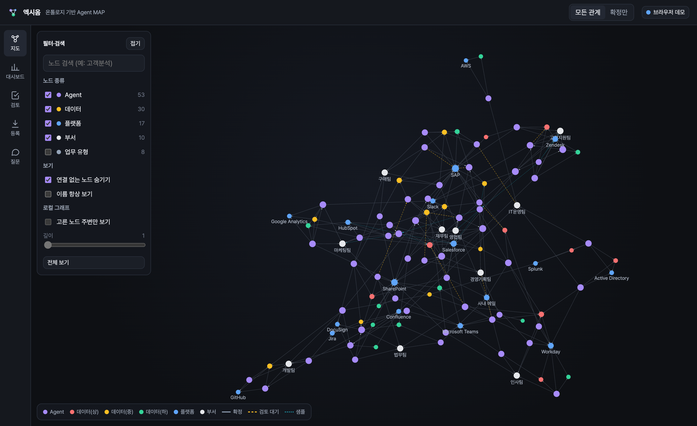
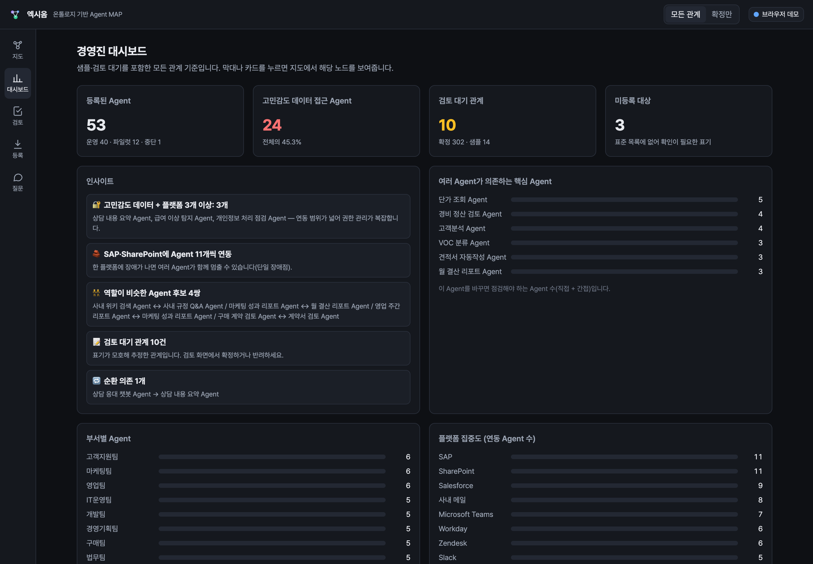
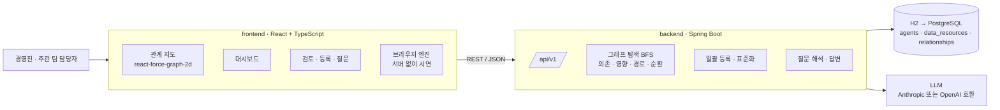

# 엑시옴 (Axiom) — 온톨로지 기반 Agent MAP

회사 안에서 쓰는 모든 AI Agent를 **업무 성격·연동 플랫폼·접근 데이터**와 연결해 하나의 지도(그래프)로 보여주는 MVP입니다. 경영진은 부서별 현황과 데이터 민감도 분포를 한눈에 보고, 담당자는 "이걸 바꾸면 어디를 점검해야 하나?"를 그래프 탐색으로 바로 확인합니다.

> 팀 프로젝트용 프로토타입입니다. 들어 있는 Agent·사람 이름·데이터는 모두 가짜입니다.



## 무엇을 할 수 있나

| 화면 | 하는 일 |
|---|---|
| **지도** | Obsidian처럼 움직이는 관계 그래프. 노드에 마우스를 올리면 이웃만 밝아지고, 확대하면 이름이 보입니다. 노드를 고르면 속성·관계·근거가 나오고, "바꾸면 영향받는 곳"·"쓰는 대상"을 누르면 탐색 결과가 경로와 함께 강조됩니다. 고른 노드 주변만 보는 로컬 그래프(깊이 1~3)도 있습니다. |
| **대시보드** | 부서별 Agent 수, 고민감도 데이터 접근 비율, 플랫폼 집중도(단일 장애점), 여러 Agent가 의존하는 핵심 Agent, 인사이트(고민감도 + 플랫폼 3개 이상, 역할이 비슷한 Agent 쌍, 순환 의존, 검토 대기). |
| **검토** | 표기가 모호해 추정만 한 관계(CANDIDATE)를 근거 원문과 출처 위치를 보고 확정·반려합니다. 표준 목록에 없는 미등록 대상도 여기서 처리합니다. |
| **등록** | 부서마다 형식이 다른 제출 파일(json·yaml·csv·xlsx·docx)을 표준 어휘(SKOS 별칭 사전)로 맞춰 일괄 등록합니다. Word 서술형은 문장에서 관계를 추출합니다. "문장에서 관계 찾기" 탭에서는 자유 문장을 넣어 볼 수 있습니다. |
| **질문** | "CRM 고객정보를 변경하면 어떤 Agent를 점검해야 하나?" 같은 질문을 그래프 조회로 바꿔 실행하고, 조회 결과에만 근거해 답합니다. 해석 결과(의도·기준 대상·방향·깊이)를 함께 보여줍니다. |

화면 위쪽의 **모든 관계 / 확정만** 전환은 그래프·탐색·집계 전체에 적용됩니다.



## 설계 원칙

- **관계 방향은 "쓰는 쪽 → 제공하는 쪽"**: 의존(dependencies)은 화살표 방향, 영향(impact)은 반대 방향으로 BFS 탐색합니다. 방문한 노드는 다시 넣지 않아 순환이 있어도 멈춥니다.
- **관계 상태 3가지**: `SAMPLE`(설계안 예시, 검증 전) · `CANDIDATE`(추정, 사람 검토 대기) · `CONFIRMED`(근거 확인 완료). 모든 관계에 근거 문구와 출처(파일·행·셀·문장)가 붙습니다.
- **AI는 원문 표기만 뽑습니다**: ID와 상태는 별칭 사전과 검증 규칙(대상 존재·중복·자기 참조)이 정합니다. 그래서 AI가 없는 Agent를 지어내도 그래프에 들어가지 않습니다.
- **답은 조회 결과에만 근거합니다**: 결과가 없으면 "발견되지 않음(안전하다고 확정할 수는 없음)"이라고 답하고, 등록되지 않은 대상은 "0개"가 아니라 "미등록"이라고 답합니다.

## 구조



- 프론트엔드는 두 가지로 동작합니다. 서버 주소를 비워 두면 **브라우저 엔진**이 `data/`의 가짜 데이터로 모든 기능을 돌립니다(규칙 기반 해석·추출). 오른쪽 위 버튼에서 백엔드 주소를 넣으면 같은 화면이 **Spring Boot API**를 씁니다.
- API 계약은 [docs/api-contract.md](docs/api-contract.md)에 있습니다. 백엔드와 브라우저 엔진이 같은 모양으로 응답합니다.

## 실행

### 프론트엔드 (브라우저 데모)

```bash
cd frontend
npm install
npm run dev        # http://localhost:5173
npm test           # 질의 정답 25개·대시보드·추출 8건·일괄 등록 재현 검사
```

### 백엔드

```bash
cd backend
./mvnw spring-boot:run          # http://localhost:8080/api/v1/health
./mvnw test
```

LLM을 쓰려면 실행 전에 키를 환경 변수로 넣습니다. 키가 없으면 규칙 기반으로 동작합니다. 자세한 설정은 [backend/README.md](backend/README.md)를 보세요.

```bash
export ANTHROPIC_API_KEY=...    # 또는 OPENAI_API_KEY + 설정에서 provider=openai
```

## 데이터

[data/README.md](data/README.md)에 자세히 있습니다. 요약하면:

- Agent 53개(부서 제출 파일 50개 + 설계안 예시 샘플 3개), 부서 10 · 업무 유형 8 · 플랫폼 17 · 데이터 30(민감도 상·중·하)
- 관계 326개(확정 302 · 검토 대기 10 · 샘플 14), 미등록 대상 3건
- 평가용 정답: 일괄 등록·추출 정답, 자연어 질의 25개(질문 해석 결과와 답), 대시보드 기댓값
- `python3 data/tools/build_dataset.py`로 다시 만들고, `python3 data/tools/verify_dataset.py`로 원본·정답·질의가 서로 맞는지 검사합니다.

## 참고한 오픈소스 패턴

코드는 가져오지 않고 설계 패턴만 참고했습니다.

- [Backstage](https://github.com/backstage/backstage) 카탈로그 그래프: 짝을 이루는 관계 이름(의존 ↔ 피의존), 깊이·방향 조절
- [OpenMetadata](https://github.com/open-metadata/OpenMetadata): 관계형 DB 하나의 관계 테이블로 그래프를 저장하는 방식, 상·하류 영향 분석 화면
- [A2A AgentCard](https://github.com/a2aproject/A2A): Agent 속성(이름·설명·제공자·역량) 구성
- [Quartz](https://github.com/jackyzha0/quartz) · [Foam](https://github.com/foambubble/foam): Obsidian식 로컬 그래프(깊이·hover 강조)

## 라이선스

[MIT](LICENSE)
